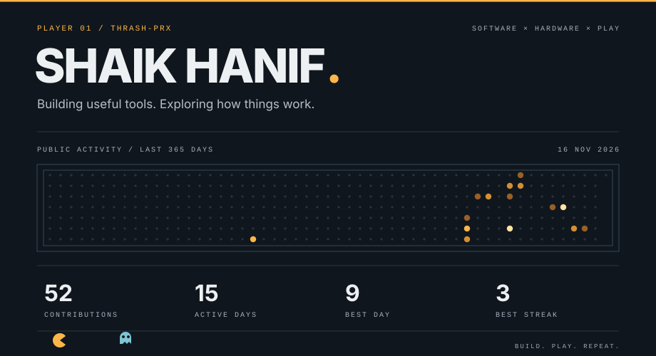

  

# Hey, I'm Hanif 👋

**I build software that makes everyday hardware and workflows more useful.**

I'm a B.Tech Computer Science student at **VIT-AP University** and President of **The Gamers Crib**. My projects span browser tools, Android assistants, Windows utilities, and hardware experiments. I care about thoughtful interfaces and understanding how things work underneath.

[Portfolio ↗](https://thrash-portfolio.vercel.app) · [LinkedIn ↗](https://www.linkedin.com/in/hanif-w1fi/) · [My repositories ↗](https://github.com/Thrash-PRX?tab=repositories)

## Things I've been building

| Project | What it does | Built with |
| :--- | :--- | :--- |
| **[THRASH-PASS](https://github.com/Thrash-PRX/THRASH-PASS)** | A browser AI assistant with configurable providers, screenshot questions, and editor insertion. | JavaScript · Browser extension APIs |
| **[JARVIS for Android](https://github.com/Thrash-PRX/Jarvis-for-Android)** | A local-first voice assistant foundation with offline commands, a Compose interface, and permission-aware device actions. | Kotlin · Jetpack Compose · Room |
| **[Thrash Lightening Control](https://github.com/Thrash-PRX/Thrash-Lightening-Control)** | A native Windows app for compatible Lenovo white-backlit keyboards, with reactive effects and local audio response. | Python · Windows APIs · PowerShell |

## What I'm exploring

- **Hardware × software:** keyboard interfaces, device communication, and useful desktop tools.
- **Better product experiences:** clear UI, practical automation, and responsive web applications.
- **[APEX CONTROL](https://github.com/Thrash-PRX/apex-control):** a research workspace for the Ant Esports APEX 200S keyboard project.

## Away from the editor

I lead **The Gamers Crib** at VIT-AP, bringing people together through gaming and build events. You'll also find me playing Valorant, editing videos, or starting another hardware experiment.

---

<strong>Build something useful. Make it feel good to use.</strong> Arcade artwork uses public GitHub activity. The refresh date is printed inside the image.

